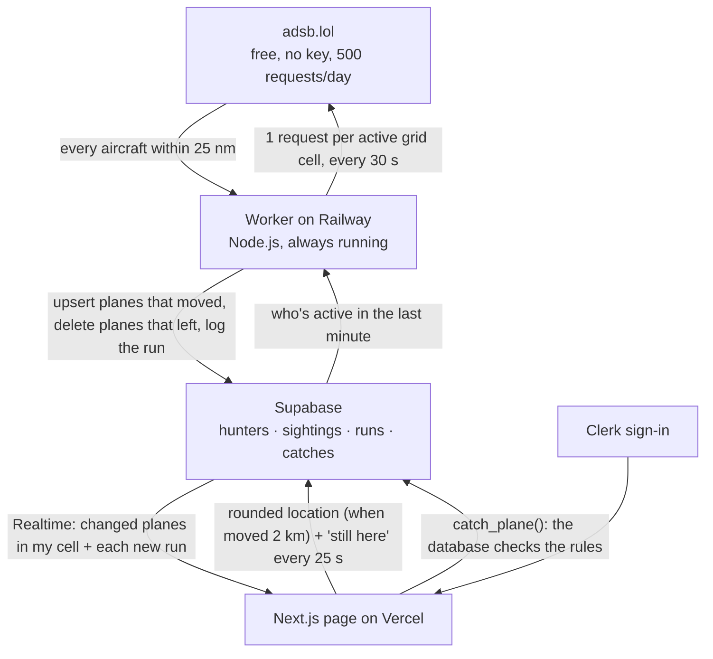

# Sky Hunt: data flow

Sky Hunt is a plane-spotting game. A map shows the real planes flying near you; catch a commercial flight while its latest position is inside your 5-mile circle (and not over an airport) to add its airline and aircraft to your collection.

The first version of this chart was committed before any code (commit `0eb87b7`). This is the design as built.

## How data moves

1. **Page → Supabase.** While the radar is open, it marks you active every 25 seconds (`touch_hunter()`), and saves your location rounded to about 1 km when you've moved about 2 km. Your exact position never leaves the browser.
2. **Supabase → worker.** Every run, the worker reads who was active in the last minute and groups them into **grid cells** (0.25°, about 17 × 13 miles in Chicago). Nobody active means no requests at all.
3. **Worker → adsb.lol.** One request per active cell (at most 4 per run, busiest first): every aircraft within 25 nautical miles of the cell's center, which covers the whole cell plus the 15 miles the page shows.
4. **Worker → Supabase.** Each aircraft becomes a `sightings` row: commercial, private, or unknown; airline and logo code; aircraft type and rarity; position, altitude, direction; whether it's over an airport's no-catch zone; and when it was pinged. Only planes that are new, moved a quarter mile, changed altitude by 300 ft, turned 10°, or haven't been saved for a minute are upserted. Planes that left are deleted. Each run adds a row to `runs`.
5. **Supabase → page.** Realtime pushes each changed plane in your cell, and each new run, to your open page. The page shows the closest planes and how fresh the data is.
6. **Catching.** `catch_plane()` checks the plane's latest ping: commercial, under 90 seconds old, within 5 miles of you (plus half a mile for rounding), not over an airport. Then it adds the catch. The page can't add catches itself.

## The shared daily budget

adsb.lol allows **500 requests per rolling 24 hours** (its `x-ratelimit-limit` header). One worker serves everyone, so the budget is app-wide:

| Used in the last 24 h | Worker | Page |
|---|---|---|
| Under 75% (375) | A run every 30 s | "Live · updated 12 s ago" |
| 75% to 90% | A run every 60 s | "Live · updated … · updating less often to save today's limit" |
| 90% or more (450) | No requests until enough age out (the worker records an estimated `resume_at`) | "Sky Hunt has used today's flight data limit. Come back later." |

A refused request (HTTP 429) also pauses requests for 5 minutes. The worker counts its own requests from `runs`, so a restart doesn't reset the count.

## Freshness states on the page

From the latest row in `runs`:

From the latest row in `runs` and the page's own live (Realtime) connection, checked in this order:

- **Loading:** before the first answer.
- **Down:** Supabase is unreachable, the live connection has been lost for over 45 seconds, no run for 5 minutes (the worker isn't running), or the latest run failed: "Flight data can't be displayed right now. Come back later."
- **Limit:** the budget pause above.
- **Connecting:** the live connection is starting or reconnecting (under 45 seconds): "Connecting to live updates…", or "Reconnecting… showing the last positions" when planes are on the map.
- **Starting:** the latest run had nobody active (you just arrived): "Looking for planes near you…".
- **Stale:** no run for 3 intervals plus 15 seconds (105 s normally): "No update for 2 min · these positions may be out of date" when planes are still shown, or "No new flight data for 3 min, so there are no recent planes to show" once they've aged off (after 2 minutes). Old positions aren't catchable.
- **Fresh:** "Live · updated 12 s ago · 8 planes within 15 mi" (or "no planes within 15 mi right now").

The status line is the only message about flight data on the Radar page; down and the daily limit replace it with one banner.

The page reconnects on its own when the live connection drops (after 3 seconds), and if it hears nothing for 75 seconds it reloads what's saved and reconnects.

## Tables

| Table | Written by | Who can read | Realtime |
|---|---|---|---|
| `hunters` | Each person (own row) | Only the owner | No |
| `sightings` | Worker (secret key) | Signed-in people | Yes |
| `runs` | Worker | Signed-in people | Yes (inserts) |
| `catches` | `catch_plane()` only | Only the owner | No |

The full schema and row-level security policies are in `supabase/migrations/`.

## What's shown near you

- Out to 15 miles. At most 12 planes inside your 5-mile circle and 15 outside it, closest first.
- Each plane points the way it's flying, with a short dashed line ahead. Planes that can't be caught are faded.
- Opening a plane shows only its airline (with logo), aircraft type, and when it was last updated, plus Catch.
- Only commercial flights can be caught. Small planes, helicopters, and business jets are "Private plane"; anything without a callsign or type, military, or not recognized is "Unknown aircraft".
