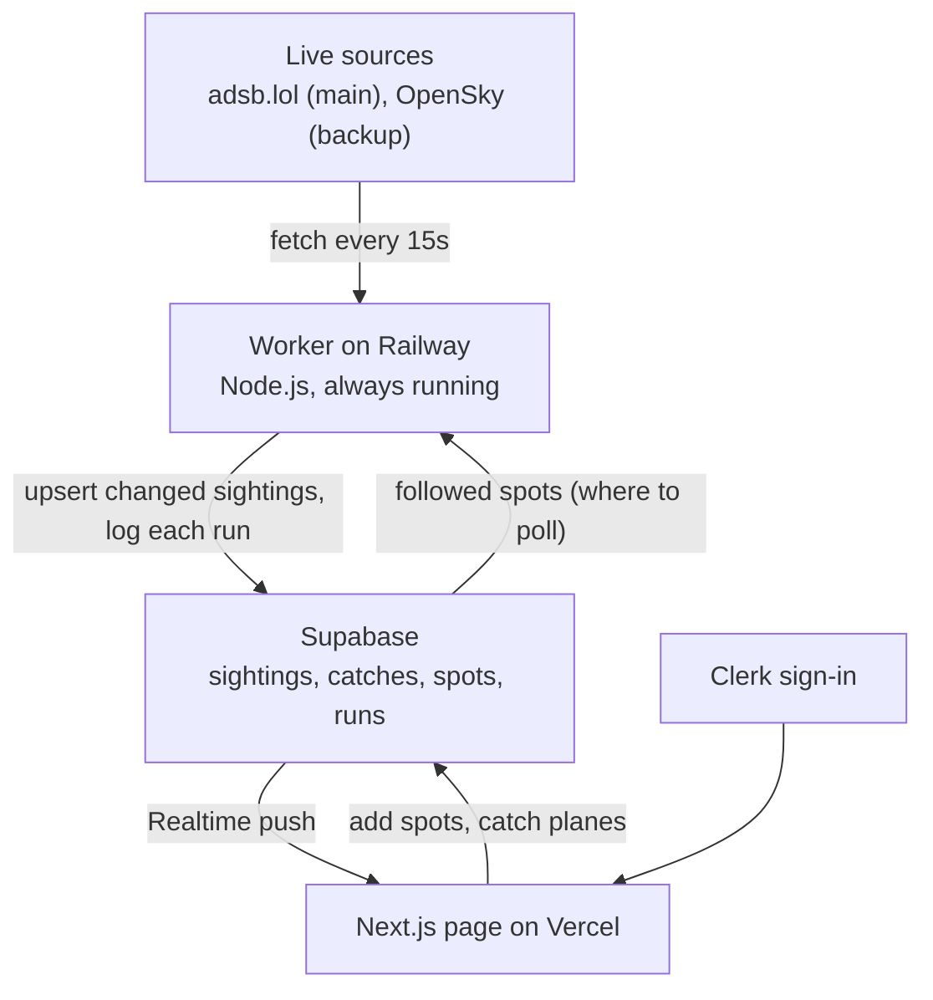

# Sky Hunt: data flow

Sky Hunt is a plane-spotting game. You follow spots (your home, O'Hare, campus). When a plane flies near one of your spots, it shows up live and you can catch it before it leaves. Rarer aircraft types and airlines are worth more.

## How data moves

1. **Source → worker.** Every 15 seconds the worker asks adsb.lol for planes around each followed spot (rounded to a grid so nearby spots share one request). If adsb.lol fails, it falls back to OpenSky.
2. **Worker → Supabase.** It compares with what it saved last time and upserts only planes that are new or moved. Planes that left every spot are deleted. Each run adds a row to `runs` (when, ok or failed, source, rows changed).
3. **Supabase → page.** Realtime pushes each change in `sightings` to open pages. The page shows planes near the signed-in person's spots.
4. **Page → Supabase.** People add spots and catch planes. Spots and catches are private (row-level security on the Clerk user ID).
5. **Freshness.** The page reads the latest row in `runs`: fresh (under a minute old), stale (a few missed runs), or down (the last run failed).

## Tables (first draft)

| Table | Written by | Who can read | Purpose |
|---|---|---|---|
| `spots` | Each person | Only the owner | Places a person follows: name, rounded lat/lon, catch radius |
| `sightings` | Worker | Signed-in people | Planes currently near any spot: hex, callsign, airline, type, position, altitude, rarity, last seen |
| `catches` | Each person (through a checked database function) | Only the owner | A person's collection: which aircraft, type, airline, points, when |
| `runs` | Worker | Signed-in people | One row per worker run, for freshness and debugging |
| `aircraft_types` | Seed data | Everyone | Type code → name and rarity tier (B788 → Boeing 787-8, uncommon) |
| `airlines` | Seed data | Everyone | ICAO code → name (UAL → United Airlines) |
| `routes` | Worker | Signed-in people | Callsign → scheduled origin and destination, looked up once |

Only `sightings` and `runs` need Realtime.
