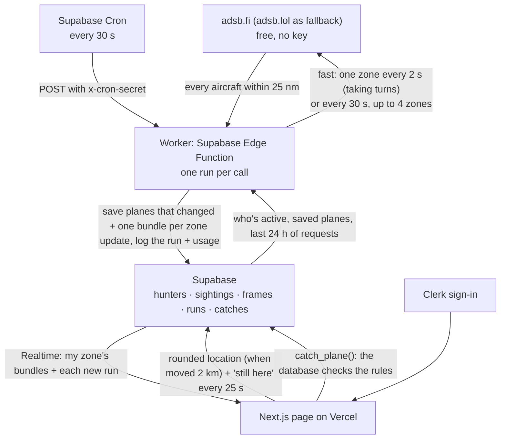

# Sky Hunt: data flow

Sky Hunt is a plane-spotting game. A map shows the real planes flying near you; catch a commercial flight while its latest position is inside your 5-mile circle (and not over an airport) to add its airline and aircraft to your collection.

The first version of this chart was committed before any code (commit `0eb87b7`). This is the design as built. The worker first ran on Railway; when Railway stopped taking new signups it moved to a Supabase Edge Function run by Supabase Cron, so the whole system is now Vercel, Supabase, and Clerk.

## How data moves

1. **Page → Supabase.** While the radar is open, it marks you active every 25 seconds (`touch_hunter()`, which also counts your 2 hours of Radar a day), and saves your location rounded to about 1 km when you've moved about 2 km. Your exact position never leaves the browser.
2. **Cron → worker → Supabase.** Every 30 seconds, Supabase Cron calls the worker (an Edge Function). A call remembers nothing from the last one, so it first reads back what earlier runs left: the saved planes, the requests made in the last 24 hours, and whether adsb.lol refused one recently. Then it reads who was active in the last minute and groups them into **grid cells** (0.25°, about 17 × 13 miles in Chicago). Nobody active means no requests at all.
3. **Worker → flight source.** Each call lasts about 22 seconds. Normally it's **fast**: every 2 seconds it asks adsb.fi for the next active zone in turn (so with one zone, it's updated every 2 s; with two, each every 4 s). Once the day's fast allowance is used (see below), or if adsb.fi refuses, it does the old **30-second pass** instead: up to 4 zones, busiest first, adsb.fi or else adsb.lol. Each request returns every aircraft within 25 nautical miles of the zone's center, which covers the whole zone plus the 15 miles the page shows.
4. **Worker → Supabase.** Each aircraft becomes a `sightings` row: commercial, private, or unknown; airline and logo code; aircraft type and rarity; position, altitude, direction; whether it's over an airport's no-catch zone; and when it was pinged. Only planes that are new, moved a quarter mile, changed altitude by 300 ft, turned 10°, or haven't been saved for a minute are upserted. Planes that left are deleted. The same changes go into **one `frames` row** for the zone (the changed planes and the ones that left), so Realtime sends one message per update instead of one per plane. Each call adds a row to `runs`, with an estimate of the messages and bytes it caused.
5. **Supabase → page.** Realtime pushes each update of your zone (one message), and each new run, to your open page. The page applies the bundle, shows the closest planes, and says how fresh the data is. A tab hidden for a minute lets go of its connection.
6. **Catching.** `catch_plane()` checks the plane's latest ping: commercial, under 90 seconds old, within 5 miles of you (plus half a mile for rounding), not over an airport. Then it adds the catch. The page can't add catches itself.

## Daily limits

Everything is on free plans, so the app limits itself per day: the reasons and numbers are in [usage-limits.md](usage-limits.md). In short:

| Limit | What happens |
|---|---|
| Under 50% of a day's share of Supabase's free Realtime messages and egress (the worker's own estimate, over 24 h) | Fast: one zone every 2 s |
| 50% to 90% | Every 30 s for everyone |
| 90% or more | Paused for everyone: "Sky Hunt has reached today's flight data limit." |
| You've used 2 hours of Radar today | The Radar stops for you until midnight UTC; the Collection still works |
| adsb.fi refuses (HTTP 429), or 12,000 requests today | adsb.lol at the old pace: every 30 s, every 60 s at 75% of its 500-a-day budget, none at 90% |

A source that refuses is skipped for 5 minutes. Both limit per IP address, and Supabase's Edge Functions share outgoing addresses with other projects, so either can refuse even when Sky Hunt has used little.

## Freshness states on the page

From the latest row in `runs` and the page's own live (Realtime) connection, checked in this order:

- **Loading:** before the first answer.
- **Down:** Supabase is unreachable, the live connection has been lost for over 45 seconds, no run for 5 minutes (the worker isn't running), or the latest run failed: "Flight data can't be displayed right now. Come back later."
- **Limit:** the budget pause above.
- **Connecting:** the live connection is starting or reconnecting (under 45 seconds): "Connecting to live updates…", or "Reconnecting… showing the last positions" when planes are on the map.
- **Starting:** the latest run had nobody active (you just arrived): "Looking for planes near you…".
- **Stale:** no run for 3 intervals plus 15 seconds (105 s normally): "No update for 2 min · these positions may be out of date" when planes are still shown, or "No new flight data for 3 min, so there are no recent planes to show" once they've aged off (after 2 minutes). Old positions aren't catchable.
- **Fresh:** "Live · updated 2 s ago · 8 planes within 15 mi" (or "no planes within 15 mi right now"), plus "updating every 30 s right now" or "updating less often to save today's limit" when it isn't fast. "Updated" is your zone's latest update.

The status line is the only message about flight data on the Radar page; down and the daily limit replace it with one banner.

The page reconnects on its own when the live connection drops (after 3 seconds), and if it hears nothing for 75 seconds it reloads what's saved and reconnects.

## Tables

| Table | Written by | Who can read | Realtime |
|---|---|---|---|
| `hunters` | Each person (own row) | Only the owner | No |
| `sightings` | Worker (secret key, on Supabase's servers) | Signed-in people | No (the page loads it; catching checks it) |
| `frames` | Worker | Signed-in people | Yes: one message per zone update |
| `runs` | Worker | Signed-in people | Yes (inserts), one per call |
| `catches` | `catch_plane()` only | Only the owner | No |

The full schema and row-level security policies are in `supabase/migrations/`.

## What's shown near you

- Out to 15 miles. At most 12 planes inside your 5-mile circle and 15 outside it, closest first.
- Each plane points the way it's flying, with a short dashed line ahead. Planes that can't be caught are faded.
- Opening a plane shows only its airline (with logo), aircraft type, and when it was last updated, plus Catch.
- Only commercial flights can be caught. Small planes, helicopters, and business jets are "Private plane"; anything without a callsign or type, military, or not recognized is "Unknown aircraft".
