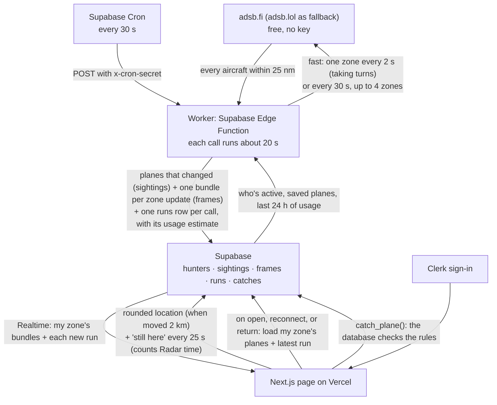

# Sky Hunt: data flow

Sky Hunt is a plane-spotting game. A map shows the real planes flying near you; catch a commercial flight while its latest position is inside your 5-mile circle (and not over an airport) to add its airline and aircraft to your collection.

The first version of this chart was committed before any code (commit `0eb87b7`). This is the design as built, after three changes:

1. The worker first ran on Railway. When Railway stopped taking new signups, it moved to a Supabase Edge Function that Supabase Cron calls, so the whole system is now Vercel, Supabase, and Clerk.
2. adsb.lol often refused requests from Supabase's shared IP addresses, so adsb.fi (same format) became the main source and adsb.lol the fallback.
3. Updates went from every 30 seconds to every 2 seconds. To keep that inside Supabase's free plan, each zone's changes are bundled into one Realtime message, and the app limits itself per day ([usage-limits.md](usage-limits.md)).

## How data moves

1. **Page → Supabase.** While the Radar is open and visible, it calls `touch_hunter()` every 25 seconds. That marks you active and adds the time to today's Radar time (2 hours a day; after that it stops marking you active). The page also saves your location, rounded to about 1 km, when you've moved about 2 km. Your exact position never leaves the browser.
2. **Cron → worker.** Every 30 seconds, Supabase Cron calls the worker (an Edge Function) with the cron secret. A call remembers nothing from the last one, so it first reads back what earlier calls left: the saved planes, and the last 24 hours of usage summed by `worker_usage()` (requests per source, the estimated Realtime messages and bytes, and whether a source refused us in the last 5 minutes). Then it reads who was active in the last minute and groups them into **zones** (grid cells of 0.25°, about 17 × 13 miles in Chicago), busiest first. Planes in zones nobody's in anymore are deleted. Nobody active means no requests at all (an `idle` call).
3. **Worker → flight source.** A call lasts about 20 seconds. Normally it's **fast**: at 0, 2, 4 … 20 seconds (11 times), it asks adsb.fi for the next zone in turn, so one zone is updated every 2 s, two zones every 4 s each, up to 8 zones. It's the **30-second pass** instead (up to 4 zones, one request every 1.1 s, adsb.fi first and adsb.lol if adsb.fi fails) when today's fast allowance is used, adsb.fi refused us in the last 5 minutes, or adsb.fi's 12,000-a-day cap is reached. If adsb.fi stops answering partway through a fast call, the rest of that call is a pass. Each request returns every aircraft within 25 nautical miles of the zone's center, which covers the whole zone plus the 15 miles the page shows.
4. **Worker → Supabase.** Each aircraft becomes a sightings row: commercial, private, or unknown; airline and logo code; aircraft type and rarity; position, altitude, direction; whether it's over an airport's no-catch zone; and when it was pinged. Only planes that are new, moved a quarter mile, changed altitude by 300 ft, turned 10°, or haven't been saved for a minute are written. Planes missing from the answer are deleted. If anything changed, the same changes go into the zone's **one `frames` row** (the changed planes, and the ones that left), so Realtime sends one message per update instead of one per plane. At the end, each call adds one row to `runs`: what it did, and its estimate of the messages and bytes it caused.
5. **Supabase → page.** Realtime pushes each update of your zone (one message) and each new run to your open page. The page applies the bundle to the planes it loaded and shows the closest ones. When it first opens, reconnects, or you return to the tab, it loads your zone's planes and the latest run directly. A tab hidden for a minute closes its live connection.
6. **Catching.** `catch_plane()` refuses if your Radar time is used up, then checks the plane's latest ping in `sightings`: commercial, under 90 seconds old, within 5 miles of you (plus half a mile for rounding), and not over an airport. Then it adds the catch. The page can't add catches itself.

## Daily limits

Everything is on free plans, so the app limits itself per day: the reasons and numbers are in [usage-limits.md](usage-limits.md). In short:

| Limit | What happens |
|---|---|
| Under 50% of a day's share of Supabase's free Realtime messages and egress (the worker's own estimate, over 24 h) | Fast: one zone every 2 s |
| 50% to 90% | Every 30 s for everyone |
| 90% or more | Paused for everyone: "Sky Hunt has reached today's flight data limit." |
| You've used 2 hours of Radar today | The Radar stops for you until midnight UTC; the Collection still works |
| adsb.fi refused in the last 5 minutes, or 12,000 requests today | The 30-second pass with adsb.lol: every 30 s, every 60 s at 75% of its 500-a-day budget, paused at 90% |

A source that refuses is skipped for 5 minutes. Both limit per IP address, and Supabase's Edge Functions share outgoing addresses with other projects, so either can refuse even when Sky Hunt has used little.

## Freshness states on the page

From the latest row in `runs`, your zone's latest bundle, and the page's own live (Realtime) connection. `feedState()` checks them in this order, so exactly one applies:

- **Loading:** before the first answer.
- **Down:** Supabase is unreachable, the live connection has been lost for over 45 seconds, or there's been no run for 5 minutes (the worker isn't running). Banner: "Flight data can't be displayed right now. Come back later. Your map and collection still work."
- **Limit:** the latest run is `paused`, meaning updates are stopped for everyone: today's share of the free plan is 90% used, both sources refused us, or adsb.fi is unavailable and adsb.lol's budget is 90% used. Banner: "Sky Hunt has reached today's flight data limit. Flight updates are paused for everyone until the limit resets. Come back later."
- **Down** (checked after Limit): the latest run failed, meaning a zone it asked about got no answer from either source.
- **Connecting:** the live connection is starting or reconnecting (under 45 seconds): "Connecting to live updates…", or "Reconnecting… showing the last positions" when planes are on the map.
- **Starting:** the latest run was `idle` (you just arrived, so the worker hasn't seen you yet): "Looking for planes near you…".
- **Stale:** no run for 3 intervals plus 15 seconds (105 s; 195 s in slow mode): "No update for 2 min · these positions may be out of date" when planes are still shown, or "No new flight data for 3 min, so there are no recent planes to show" once they've aged off (after 2 minutes). Old positions aren't catchable.
- **Fresh:** "Live · updated 2 s ago · 8 planes within 15 mi" (or "no planes within 15 mi right now"). "Updated" is the newer of your zone's latest bundle and the latest run. When it isn't fast, it adds "updating every 30 s right now" (the 30-second pass) or "updating less often to save today's limit" (slow mode).

The status line is the only message about flight data on the Radar; down and limit replace it with one banner. Under it, "X of Radar time left today" appears once you've used some; when it reaches 0, a panel replaces both and says the Radar is back at midnight UTC.

The page reconnects on its own when the live connection drops (after 3 seconds), and if it hears nothing for 75 seconds it reloads what's saved and reconnects.

## Tables

| Table | Written by | Who can read | Realtime |
|---|---|---|---|
| `hunters` | Each person, own row: only `onboarded`, `lat`, `lon`, `location_at`. Activity and Radar time only through `touch_hunter()` and `catch_plane()` | Only the owner | No |
| `sightings` | Worker (secret key, on Supabase's servers) | Signed-in people | No (the page loads it; catching checks it) |
| `frames` | Worker (one row per zone, overwritten on each update with changes) | Signed-in people | Yes: one message per zone update, filtered to your zone |
| `runs` | Worker, one row per call (kept 7 days) | Signed-in people | Yes: each insert, to every open Radar |
| `catches` | `catch_plane()` only | Only the owner | No |

The full schema and row-level security policies are in `supabase/migrations/`.

## What's shown near you

- Out to 15 miles. At most 12 planes inside your 5-mile circle and 15 outside it, closest first.
- Each plane points the way it's flying, with a short dashed line ahead. Planes that can't be caught are faded.
- Opening a plane shows only its airline (with logo), aircraft type, and when it was last updated, plus Catch.
- Only commercial flights can be caught. Small planes, helicopters, and business jets are "Private plane"; anything without a callsign or type, military, or not recognized is "Unknown aircraft".
