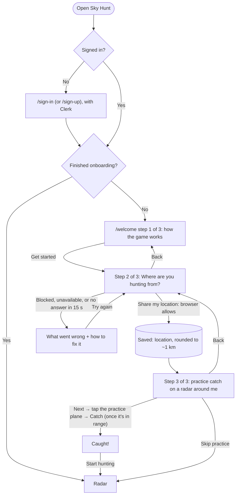
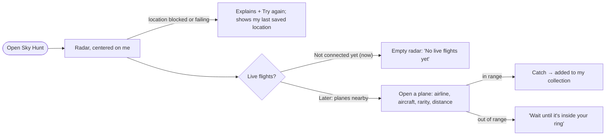

# Flows

Sky Hunt's flows: the first visit (signing up and onboarding), the main flow, and the collection.

## First visit

> **I open Sky Hunt → I sign up → I read how the game works → I share my location → I practice catching a plane on a radar around me → I land on my radar.**

- Every page except `/sign-in` and `/sign-up` needs an account. Signing out is in the account menu (top right).
- Location is required: there's no skip. If the browser blocks it, the step says how to allow it (the icon left of the address bar → Location → Allow), with Try again.
- Each step has its own URL (`/welcome?step=overview|location|tutorial`), so Back goes to the previous step. Reloading lands on the step you'd reached, never past an unanswered one.
- The practice plane is made up and its catch isn't saved. With reduced motion on, it doesn't move.

## Main flow

> **I open Sky Hunt → my radar is centered on where I am → planes near me show up → I open one and catch it before it leaves my 10-mile range → it's added to my collection.**

**States (now)**
- Loading: a skeleton, never a flash of "empty".
- Finding you: a spinner next to the location line.
- Following your location: "Near Chicago, Illinois · Following your location".
- Location problem: what went wrong, how to fix it, Try again; the radar uses the last saved location meanwhile.
- Flight feed: "Live flights: not connected yet", with empty states on the radar and the list.

**States (when the worker is connected)**
- Loading, fresh ("Updated 12 s ago"), stale (no update for a few missed runs), and down (the worker's last run failed), from the `runs` table.

## Collection

> **I open Collection → I see my totals → I switch between Airlines and Aircraft → each shows what I've caught, rarest first.**

- Totals: planes caught, airlines, aircraft types, points.
- Airlines and Aircraft are tabs (arrow keys move between them). Each row shows the name, code, how many times caught, when last caught, and its best rarity.
- Empty: "No airlines yet." / "No aircraft yet.", with a button back to the radar.
