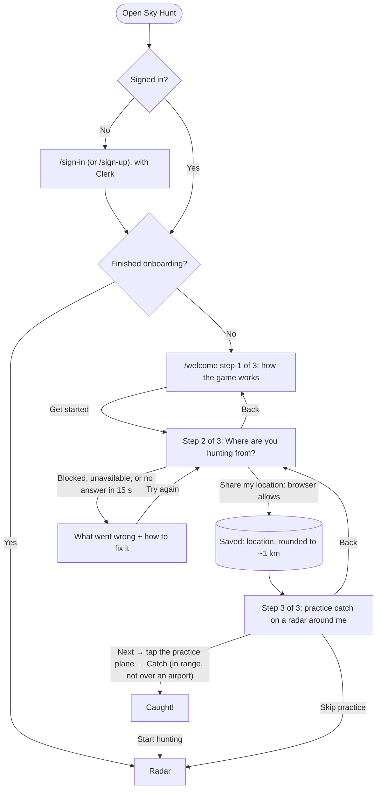
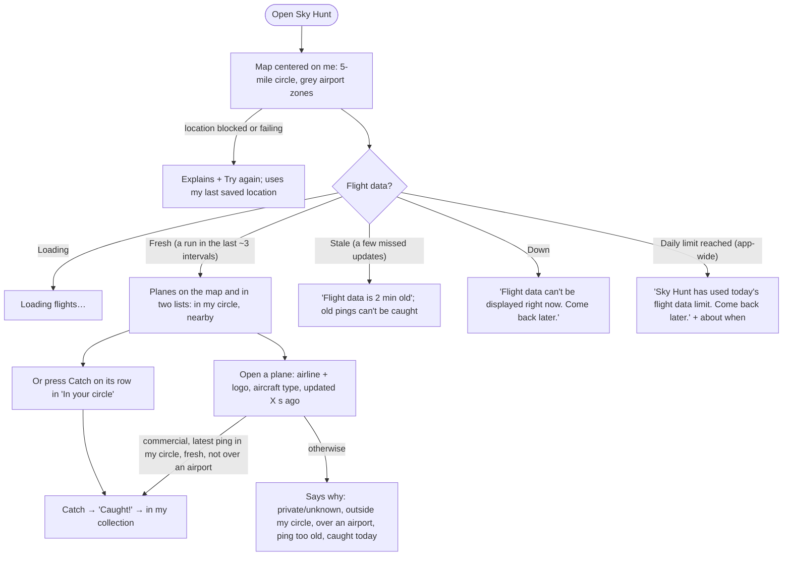

# Flows

Sky Hunt's flows: the first visit (signing up and onboarding), the main flow, and the collection.

## First visit

> **I open Sky Hunt → I sign up → I read how the game works → I share my location → I practice catching a plane on a radar around me → I land on my radar.**

- Every page except `/sign-in` and `/sign-up` needs an account. Signing out is in the account menu (top right).
- Location is required: there's no skip. If the browser blocks it, the step says how to allow it (the icon left of the address bar → Location → Allow), with Try again.
- Each step has its own URL (`/welcome?step=overview|location|tutorial`), so Back goes to the previous step. Reloading lands on the step you'd reached, never past an unanswered one.
- The practice plane is made up and its catch isn't saved. Like real flight data, its position jumps every 10 to 15 seconds (it cruises at 24,000 ft, about 450 mph), so it's catchable for about 80 seconds per pass. Grey airport zones near you show on the practice radar too.
- If your account can't be loaded, a banner says so at the top (while developing, with the technical reason). If the browser finds you but the save fails, the step says "We found you, but couldn't save it to your account." and stays put; finishing onboarding works the same way.

## Main flow

> **I open Sky Hunt → a map is centered on where I am, with my 5-mile catch circle in blue and airports in grey → within about 30 seconds, real planes near me appear, pointing the way they're flying → I open one: its airline and logo, aircraft type, and when it was last updated → if it's a commercial flight whose latest ping was inside my circle (and not over an airport), I catch it → it's in my collection.**

**What's shown**
- Planes out to 15 miles: at most 12 inside my 5-mile circle and 15 outside it, closest first.
- Each plane points the way it's flying, with a short dashed line ahead. Faded planes can't be caught.
- Commercial flights show their airline. Small planes, helicopters, and business jets are "Private plane"; anything without a callsign or type, or not recognized, is "Unknown aircraft". Neither can be caught.
- Positions update about every 30 seconds (every minute on busy days), so planes jump rather than glide.

**States**
- Loading: a skeleton, then "Loading flights…".
- Finding me: a spinner next to the location line. Following: "Near Chicago, Illinois · Following your location". The map follows me until I drag it; "Back to me" re-centers. Zoom with + and −, scroll, or pinch.
- Fresh: "Live · updated 12 s ago" (plus "every minute today" when the shared budget is 75–90% used). It stays fresh until about 3 update intervals pass with no successful run (under 2 minutes normally). Just arrived and nobody was active yet: "Looking for planes near you…".
- Stale, down, and daily limit: as in the chart, each shown once (down and limit as a banner, with no extra pill). Down also covers the worker not running at all (no run for 5 minutes) and a lost live connection. Down and limit hide the planes; the map and collection still work.
- Inside an airport zone: a note that only planes outside the grey zone can be caught.
- Opening a plane (on the map or in the lists) marks it clearly on the map (bigger, accent-colored, on a highlighted disc with a pulsing ring, drawn on top, with a bolder direction line) and shows its card directly below the map, before everything else, with Catch. The page scrolls only as much as needed to show the card; from the lists, it scrolls back up to the map. Close it with Close, or by tapping empty map.
- Below the map, **In your circle** lists each plane with its own **Catch** button, so several can be caught in a row without opening anything. When one can't be caught, the row says why in a word or two ("Private", "Over ORD", "Caught today", "Waiting for update"). After a catch, the row (and card) show "Caught · +25 pts". **Nearby, outside your circle** is view-only: tap a plane to see it on the map.
- A catch that fails says why, in words (from the database's check).

## Collection

> **I open Collection → I see my totals → I switch between Airlines and Aircraft → each shows what I've caught, rarest first.**

- Totals: planes caught, airlines, aircraft types, points.
- Airlines and Aircraft are tabs (arrow keys move between them). Each row shows the name (airlines with their logo), code, how many times caught, total points, when last caught, and its best rarity.
- Pressing a row opens its catches: each flight's callsign, its aircraft (in Airlines) or airline (in Aircraft), rarity, points earned, and when it was caught. Press again to close.
- Empty: "No airlines yet." / "No aircraft yet.", with a button back to the radar.
